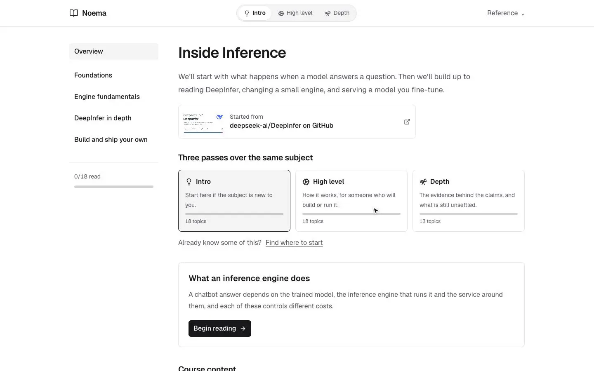
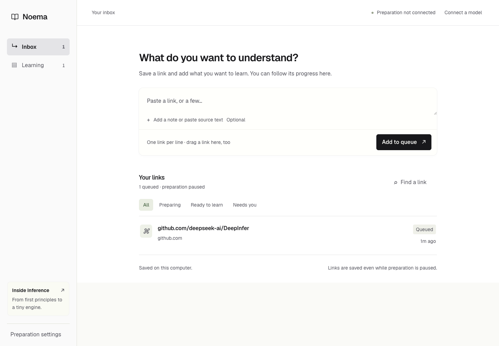
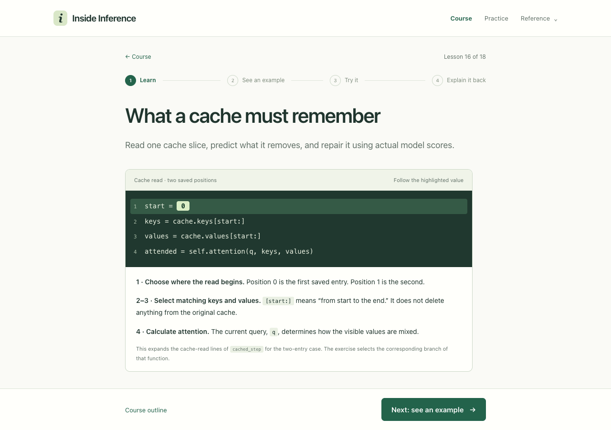
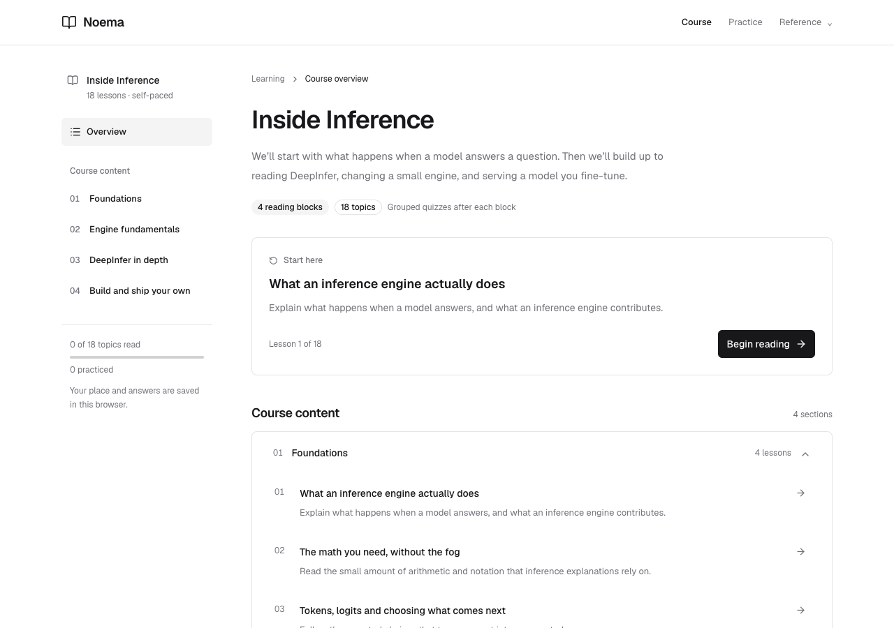
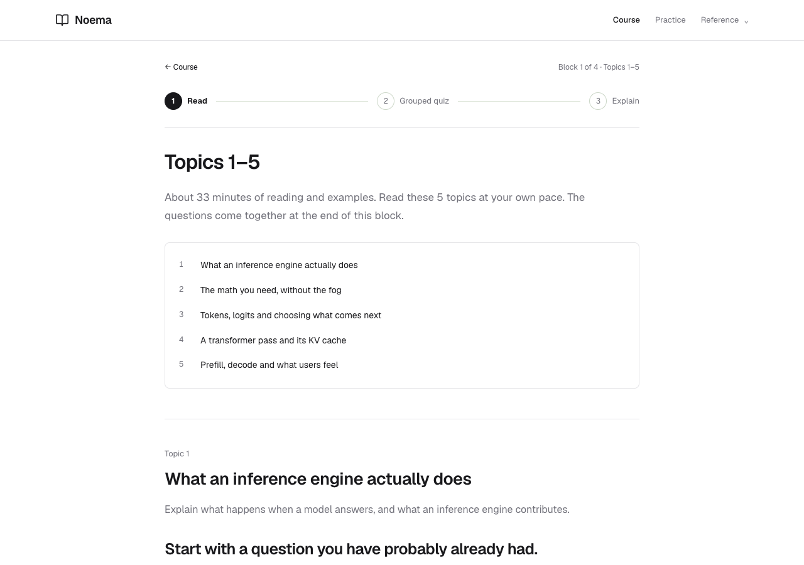

# Noema

Save links you want to understand, then work through the lessons Noema prepares
for you. The inbox keeps your reading ideas in one place: a tweet, an article,
a repository, or several links you have been meaning to explore.

<p align="center">
  
</p>
<p align="center"><sub>The bundled <b>Inside Inference</b> course, built from the DeepInfer repository: three passes over the same subject, glossary and source previews on hover, and scenario questions with feedback at the end of each reading block.</sub></p>



## Start Noema

Requires **Bun 1.4.3**. The included inference lab also needs Python 3.9+; ordinary article courses do not. No GPU or model download is needed.

```bash
git clone https://github.com/2018kguo/noema.git
cd noema
bun install --frozen-lockfile
bun run start
```

Open **http://127.0.0.1:8765**. Paste one or more links and add a note about what
you want to understand. Open **Settings** to see whether the Claude Code and
Codex CLIs are installed and signed in; if one isn't, Settings shows the command
to run (`claude auth login` or `codex login`) and a Recheck button. Noema never
handles or stores your login. Pick a CLI and, optionally, a model. Preparation
uses that account's usage limits. You can capture links before connecting a
model; they stay queued until you start preparation.

The queue reads the source, plans prerequisites, writes lessons and guided
reviews, then makes a separate editing pass. It handles one item at a time and
shows the current stage. Pause or stop an item whenever you want. Drafts are
checkpointed, so a restart can resume completed steps. A call interrupted before
its result was saved may need to run again.

- **Inbox:** capture, search, filter, inspect progress, retry, and add missing text.
- **Reading aids:** specialist terms show their definition on hover, and citations show a source card. A quoted citation opens the source in a new tab, scrolled to and highlighting the passage. Lessons embed images and YouTube videos where they show something better than words, and each course card shows the link that started it.
- **Three passes:** a course runs as Intro, High level and Depth, each a separate pass over the same subject with its own reading, questions and progress. A short placement quiz picks where to start, and a switch at the top of every page changes pass without losing your place.
- **Learning:** see topics read, topics practiced, and where to resume each course. Reading and worked examples are grouped into blocks estimated at about 30 minutes; the quiz follows the block. There is no timer or waiting requirement.
- **Share:** open a ready item and choose **Download to share**.

Public tweets use the embed endpoint when it is available, with a bounded read
of linked pages. If the post is inaccessible, paste its text in the item. Noema
does not sign into social accounts or import an entire bookmark collection.
Public GitHub links resolve their branch or revision to a pinned commit, then
read its README and up to four selected entry/engine files. Ordinary articles include up to four
related same-site article links. These are bounded reads, not full-site or
whole-repository audits. Every generated course has a Sources page with the
reading scope and gaps. Use the skill and archive crawler below for a deeper
collection or a particular repository revision.

The server needs to keep running for preparation to continue. The browser tab
can close. This is a local application: the private SQLite inbox, source reads,
and generated courses live in ignored `local-data/`. Stop the server before
copying that directory for a backup. Provider credentials stay in the CLI's own
login or the server environment. Browser learning progress is separate and can be exported from a
course's Reference menu.

You can also configure preparation at startup:

```bash
bun run start --generate-provider claude --generate-model haiku
bun run start --generate-provider codex
```

Settings persist locally. You choose the model; there is no automatic switch to
a more expensive provider. Automatic generation currently supports the two CLIs.
The OpenRouter/Jev adapters below are for answer feedback.

## Try the included course

**Inside Inference** has 18 lessons at up to three depths, a placement quiz, prerequisite links, seven guided
review scenarios, and a small Python engine. It starts with no assumed machine
learning background and builds toward reading DeepInfer and working on inference
systems.

Open **http://127.0.0.1:8765/learn/deepinfer/**, or start at the cache lesson:
**http://127.0.0.1:8765/learn/deepinfer/#lesson/workshop/learn**.



The highlighted code is visible before you run anything. Predict what a changed
slice will do, run the real Python calculation, inspect the scores, then repair
it. The control selects a fixed branch of the engine. The wider reference suite
makes 218 comparisons covering cached scores, generation, separate request state,
a low-rank update, and the context boundary. This tiny randomly initialized model
teaches engine correctness; it is not a language model or a GPU benchmark.

For a single course without the inbox:

```bash
bun run start --course courses/deepinfer
```





## Add live feedback

You can compare every written answer with a worked explanation for free. Live
feedback is optional and uses the same CLI and model you chose in **Settings**.
To use a different one for feedback only, pass it when starting the server:

```bash
bun run start --provider claude --model haiku
bun run start --provider codex
```

These call the installed CLI using its existing login. Account limits, model
availability, and CLI versions apply. Codex's
[non-interactive mode](https://developers.openai.com/codex/noninteractive/)
supports saved authentication and structured responses. See
[Claude's CLI documentation](https://code.claude.com/docs/en/headless) for its
non-interactive interface. Recent CLIs are needed for the isolation flags used
here; an unsupported flag produces an error, not a silent fallback.

To include selected code excerpts in review feedback, add
`--repo /path/to/a/DeepInfer/checkout`. The sample targets commit
`774ce244b87cc0eb8d4b94ab9f5de2ab22049f01`. Only explicitly listed files are
read, with size and line limits. Graders get excerpts, not repository tools.

For OpenRouter, supply `OPENROUTER_API_KEY` in the server environment, then run:

```bash
bun run start --provider openrouter --model YOUR_STRUCTURED_OUTPUT_MODEL_ID
bun run start --provider jev --model typesafe/jev-1.13
```

OpenRouter's [structured outputs](https://openrouter.ai/docs/guides/features/structured-outputs)
adapter uses chat completions. The
[Jev adapter](https://openrouter.ai/blog/tutorials/how-to-use-jev/) uses the
Decisions API and returns criterion probabilities, without calibrated pass
thresholds. Those two adapters have contract tests; live OpenRouter/Jev calls
have not been verified with a funded key. Codex and Claude were smoke-tested
locally. No price or grading accuracy is promised.

Feedback cites the submitted answer and records exercise/context hashes. Editing
an answer or changing an exercise marks old feedback as stale. AI feedback helps
you revise; it does not certify mastery. Progress stays in browser local storage.
Live feedback sends the answer, rubric, and selected context to the provider.
Keep this server on loopback; it has no public multi-user authentication.

## Use the skill for deeper work

Open this repo in Codex or Claude Code and ask it to read
[`skills/noema/SKILL.md`](skills/noema/SKILL.md). For example:

> Use the noema skill on this URL and its related posts. Assume I am
> new to the subject. Teach the prerequisites, help me assess the authors' claims,
> and make me apply the ideas. Keep the generated course in local-courses/topic.

The repo includes discovery symlinks for Codex and Claude Code. To use the skill
from other working directories, keep this clone and symlink its skill folder
into `~/.agents/skills/noema` (Codex) or
`~/.claude/skills/noema` (Claude Code). Do not overwrite an existing
skill. Symlinks preserve the connection to this repo's runtime. The skill also
works by giving an agent the file path directly.

For archived blogs, the reusable crawler finds pages through Wayback's index and
same-site article links:

```bash
bun run course init local-courses/topic --id topic --title 'My topic'
bun run crawl https://example.org/blog/a-post \
  --archive-at YYYYMMDDhhmmss --out local-courses/topic/sources
```

`init` deliberately refuses to overwrite an existing directory. Ask the agent to author the course using
the crawl and [`docs/AUTHORING.md`](docs/AUTHORING.md). Validate and serve it:

```bash
bun run course validate local-courses/topic
bun run start --course local-courses/topic --port 8766
```

The inbox automates generation through the selected CLI, with model tools disabled.
The skill gives a coding agent the fuller workflow: it can inspect more prior work,
write custom activities, and verify a course in a real browser. Give it several
bookmarks in one task if useful. Modal execution, social-account bookmark sync,
and multi-user hosting are not built in.

`src/crawl.ts` saves raw pages, readable text, a link graph, hashes, timestamps, and
coverage in `manifest.json`. It resumes fetched pages and retries failures with
`--retry-unavailable`. Captures are the nearest available to the requested date;
each actual capture date is recorded and may differ. External citations are
inventoried, not recursively crawled. An agent follows the relevant primary
sources separately. An exhausted queue can still have partial coverage.

To put a thoroughly crawled collection in the same inbox:

```bash
bun run inbox add https://example.org/blog/a-post \
  --sources local-courses/topic/sources --note 'Teach the prerequisites and judge the claims.'
bun run inbox status
```

The worker uses that manifest's collected documents rather than the default
bounded article read. `src/cli.ts inbox` and the browser use the same persistent queue.

## Share a course

For a ready inbox item, choose **Download to share**. For the included sample, share this repo. For a locally generated course:

```bash
bun run course bundle local-courses/topic --out dist/topic.zip
```

Send the ZIP. The recipient unzips it, runs
`bun serve.js`, and opens http://127.0.0.1:8765. They get the
same lessons and exercises and can connect their own grader. Bun 1.4.3 is required; the ZIP includes a bundled server, so no dependency install is needed. The bundle includes
the runtime and selected course JSON only. It excludes raw crawls, browser
progress, keys, and local provider settings. Review your authored course text
before sharing it; the bundle cannot determine whether you included private text
inside a lesson.

Your `127.0.0.1` link works only on your computer. A static host alone cannot run the optional Python exercise or signed-in CLI graders. Public hosting would need a separate
deployment with authentication, per-user state, and execution isolation; that is
outside this local prototype.

## Develop and verify

The reader uses real [shadcn/ui](https://ui.shadcn.com/) components built on Radix, with self-hosted Geist typography and Lucide icons. The course overview follows a documentation layout with a section sidebar and full-width topic rows. Structured flow and cohort visuals follow
the worked example step by step. Cohort experiments keep the original calculation
beside a changed assumption; motion respects the reader's reduced-motion setting.
See [the authoring guide](docs/AUTHORING.md) for the data shapes and writing rules.
Generated lessons use these shared components instead of generating scripts.

All application source is TypeScript: the Bun HTTP server, SQLite queue, source reader, crawler, generation pipeline, graders, browser reader, and React components. Browser JavaScript and `vendor/` are generated assets. The server/domain and React components use strict checking; the migrated browser controller currently permits implicit parameter types and nullable DOM lookups while its saved-state and progress models are explicit.

Use Bun 1.4.3, `tsrs` for checking, Oxlint for linting, and Oxfmt for formatting. Dependencies are pinned in `bun.lock`. Rebuild and commit browser assets when their source changes; exported courses use those same local assets, with no CDN.

```bash
bun install --frozen-lockfile
bun run build:ui
bun run fmt:check
bun run lint
bun run typecheck
bun test tests/core.test.ts tests/generation.test.ts
python3 tiny_engine.py test
```

Browser regressions use [agent-browser](https://github.com/vercel-labs/agent-browser) 0.37.1 and real Chromium. They include feedback freshness, code repair, mobile geometry, uninterrupted reading, and grouped quizzes. They make no model calls.

```bash
bun install -g agent-browser@0.37.1
agent-browser install
bun test tests/browser.test.ts
```

CI checks the same pinned stack and verifies that rebuilding produces the committed assets. `bun run evaluate --provider claude --model haiku` is an opt-in live smoke test that uses your provider account; it does not establish grading accuracy or calibration.

## What lives where

| Path                                                         | Purpose                                                          |
| ------------------------------------------------------------ | ---------------------------------------------------------------- |
| `skills/noema/`                                              | Reusable discovery, teaching, writing, and verification workflow |
| `courses/deepinfer/`                                         | Public sample lessons, sources, and review rubrics               |
| `src/course.ts`, `src/share.ts`, `src/cli.ts`                | Validation, scaffolding, portable sharing, commands              |
| `src/server.ts`, `src/grade.ts`                              | Loopback HTTP server and rubric-driven grading                   |
| `src/inbox-store.ts`, `src/inbox-worker.ts`                  | Existing SQLite queue and leased work claims                     |
| `src/source-reader.ts`, `src/generation.ts`, `src/crawl.ts`  | Collection, checkpointed authoring, archive coverage             |
| `browser/`                                                   | TypeScript reader, inbox, progress and structured visuals        |
| `ui/`                                                        | React components and pinned shadcn source                        |
| `app.js`, `inbox.js`, `progress.js`, `visuals.js`, `vendor/` | Generated offline browser assets                                 |
| `tiny_engine.py`                                             | Sample's optional fixed CPU exercise plugin                      |
| `tests/`                                                     | Bun unit, integration, portability and browser regressions       |
| `local-data/`, `local-courses/`, `dist/`                     | Ignored queue, private work, and share bundles                   |

Code and original teaching material are MIT licensed. Linked repositories,
papers, articles, and their authors' names retain their own rights. Third-party
source repositories and raw blog crawls are not included. Learning design draws
on retrieval practice, worked examples, and Andy Matuschak's mnemonic-medium
work; the sample's Sources page links the research. This course has not itself
been validated in a learning study.
